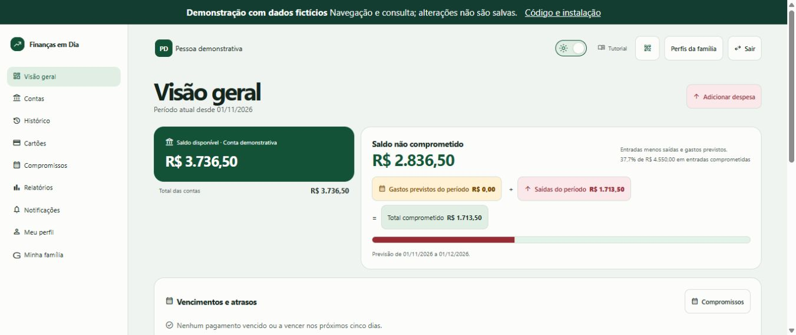

# Finanças em Dia

Aplicação web de Ricardo Nelber para organizar contas, movimentações, cartões,
compromissos e relatórios financeiros pessoais e familiares.
Interface em HTML/CSS/JavaScript e servidor Node.js com banco SQLite local.

**[Abrir demonstração](https://financas-em-dia-ricardo-demo.rick00-oo.chatgpt.site)** ·
**[Portfólio do autor](https://ricard0-o.github.io/ricardonelberdev/)**

## Demonstração

A demonstração reutiliza a interface com respostas fictícias geradas pelo próprio
servidor em um banco temporário. Permite navegar por contas, histórico, cartões,
compromissos e relatórios. O aviso na tela identifica o modo somente consulta.
Alterações financeiras, login real, cadastro, notificações e administração não são
executados online. Nenhuma chamada demonstrativa `/api/` é enviada ao servidor pessoal do autor.
Filtros da demonstração exibem o mesmo conjunto de exemplo; a aplicação completa
executa os filtros no servidor. Não informe dados pessoais na demonstração.



## Funcionalidades do código

- Perfis com senha e acesso individual.
- Contas disponíveis, reservas e investimentos.
- Receitas, despesas, transferências e períodos salariais.
- Cartões, compras parceladas, faturas e correção de datas.
- Compromissos recorrentes e pagamentos previstos.
- Relatórios por período e categoria, com conciliação de saldos.
- Grupos familiares e consulta condicionada a consentimento.
- Tema claro/escuro, interface responsiva e notificações Web Push opcionais.

## Requisitos

- **Node.js 24 ou superior**. O banco usa `node:sqlite`, incluído no Node.
- Navegador moderno com JavaScript.
- Pasta gravável para o arquivo SQLite.
- HTTPS e configuração de contato VAPID apenas se quiser Web Push.

Não é necessário instalar um servidor MySQL, Composer ou dependências de produção do npm.

## Instalação e primeiro acesso

```sh
git clone https://github.com/Ricard0-o/financas-em-dia.git
cd financas-em-dia
npm ci --ignore-scripts
npm start
```

Abra `http://localhost:8091` **no computador que executa o servidor** e crie o primeiro
administrador com sua própria senha. Essa inicialização exige acesso local.
O banco vazio é criado automaticamente em `dados/financas.sqlite`; não há senha padrão.
Complete os contatos que o sistema pedir no seu ambiente e cadastre as primeiras contas/categorias.

Para restringir o servidor ao próprio computador, no PowerShell:

```powershell
$env:FINANCAS_HOST = '127.0.0.1'
npm start
```

Por padrão o código atende em `0.0.0.0`, permitindo acesso na rede local conforme
as regras do firewall. Isso não publica o sistema automaticamente na internet.
Não exponha a aplicação antes de concluir a configuração do administrador e revisar HTTPS.

## Configuração

| Variável | Finalidade | Padrão |
| --- | --- | --- |
| `FINANCAS_HOST` | Interface de rede | `0.0.0.0` |
| `FINANCAS_PORTA` | Porta HTTP | `8091` |
| `FINANCAS_BANCO` | Caminho do SQLite | `dados/financas.sqlite` |
| `FINANCAS_PUBLICO` | Pasta dos arquivos estáticos | `publico/` |
| `FINANCAS_ORIGEM_PUBLICA` | Origem HTTPS pública explícita | desativada |
| `FINANCAS_PUSH_CONTATO` | Contato VAPID no formato `mailto:...` | desativado |
| `FINANCAS_TLS_CHAVE` / `FINANCAS_TLS_CERT` | Chave e certificado TLS, usados juntos | desativados |

Se preferir, copie `configuracao-exemplo.json` para `configuracao-local.json` e
configure origem/contato. Esse arquivo é ignorado pelo Git. Variáveis de ambiente
têm prioridade. Não publique certificados, chaves, configurações pessoais ou o banco.
O projeto não carrega `.env` automaticamente; defina as variáveis no processo/sistema.

Web Push precisa de HTTPS e permissão do navegador. E-mail, SMS e WhatsApp não têm
provedores de envio configurados nesta publicação. Nenhum túnel pessoal acompanha o projeto.

## Como funciona

```text
Navegador → fetch + JSON → servidor.mjs → regras de domínio → node:sqlite → arquivo local
```

- `publico/`: telas, estilos, gráficos e service worker.
- `servidor.mjs`: HTTP/HTTPS e roteamento da API.
- `banco.mjs` e `*-schema.mjs`: criação/evolução do banco vazio.
- `acesso.mjs` e `grupos.mjs`: autenticação, permissões e famílias.
- `movimentacoes.mjs`, `compromissos.mjs`, `periodos.mjs` e `relatorios.mjs`: regras financeiras.
- `notificacoes.mjs`: avisos Web Push.
- `*.test.mjs`: testes com bancos temporários, separados do banco de uso.

Os valores monetários são tratados em centavos. Movimentações afetam os saldos;
pagamentos previstos não devem ser contados como pagamentos realizados.

## Testes e geração da demonstração

```sh
npm run check
npm test
npm run demo:build
```

O gerador cria um banco temporário novo, cadastra exemplos fictícios pela API,
exporta somente respostas de consulta e apaga o banco temporário. Nunca exporta
o arquivo `dados/financas.sqlite`. A saída navegável fica em `demo/`.
Os testes também verificam separação de perfis, consentimento, autenticação,
CSRF, parcelamento e conciliação. Não substituem uma auditoria completa de segurança.

## Cuidados de operação

- Preserve `dados/` fora do repositório e faça backups consistentes do SQLite, considerando WAL.
- Para manutenção, pare o servidor antes de copiar/restaurar o banco, ou use uma estratégia de backup do SQLite.
- Os utilitários de migração/manutenção não devem ser executados em um banco real sem backup e leitura do código.
- Não envie banco, sessões, fotos, backups ou exportações em issues.
- A demonstração pública não é um serviço para guardar finanças reais.

## Autoria e licença

Ricardo Nelber — [GitHub](https://github.com/Ricard0-o).
Código autoral com direitos reservados; consulte [LICENSE](LICENSE) e
[componentes de terceiros](THIRD_PARTY_NOTICES.md).
Veja [CONTRIBUTING.md](CONTRIBUTING.md), [SECURITY.md](SECURITY.md) e [CHANGELOG.md](CHANGELOG.md).
